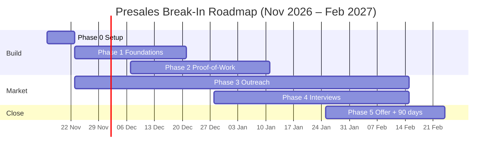

# 🎯 Presales Break-In Roadmap

### From BD Intern → Associate Presales / Solutions Engineer in 12 Weeks

**Engineer who's built AI MVPs and sold to listed enterprises. I run discovery, build the POC and explain the ROI.**

---

## 📌 TL;DR

> Presales managers don't hire freshers for degrees or certificates. They hire the person who **asks before telling**, **links features to business numbers**, **takes coaching between rounds**, and is **genuinely curious about their product**.
>
> I already have the two things managers usually have to train: **customer conversations** (GreyShade, VAYUZ) and **technical skill** (AI startup MVP + LLM evaluation).
> What's missing is **visible proof**. This roadmap builds that proof in 12 weeks.

---

## 📚 Table of Contents

- [Problem & Goal](#-problem--goal)
- [Target User: The Hiring Manager](#-target-user-the-hiring-manager)
- [Success Metrics](#-success-metrics)
- [Roadmap Timeline](#️-roadmap-timeline)
- [Phase 0: Setup](#phase-0--setup)
- [Phase 1: Foundations](#phase-1--foundations)
- [Phase 2: Proof-of-Work](#phase-2--proof-of-work)
- [Phase 3: Visibility & Outreach](#phase-3--visibility--outreach)
- [Phase 4: Interview Mastery](#phase-4--interview-mastery)
- [Phase 5: Offer & First 90 Days](#phase-5--offer--first-90-days)
- [Weekly Schedule](#-weekly-schedule)
- [What Separates Me from Average](#-what-separates-me-from-average)
- [Evidence Gaps](#️-evidence-gaps)
- [Sources](#-sources)

---

## 🧩 Problem & Goal

### Problem
**I want a presales seat, but the market's default answer to my profile is "SDR".**
- Most NCR presales postings ask for **2–5+ years**
- Many Indian fresher "presales" jobs are actually **tender/RFP compliance** work
- SDR → SE is *possible but not the easiest route*, and much easier internally than via cold applications

### 🎯 Goal
**One signed offer by ~15 Feb 2027** for one of these roles: Associate Presales / Solutions Consultant / Solutions Engineer, *or* an implementation role with a **written path into presales**. Conditions:

| Condition | Requirement |
|---|---|
| 💰 Pay | **≥ ₹40k/month fixed** (variable on top) |
| 🏢 Location | Office-based in Gurugram / Delhi / Noida (Bengaluru second) |
| 📊 Variable pay | Tied mostly to **my own work**, not company-level targets |

### 🚫 Non-Goals (the kill list)
- [ ] No second certification until the offer is signed
- [ ] No GTM engineering course, no Founder's Office applications, no new content series
- [ ] No resigning from VAYUZ before a **signed** offer letter
- [ ] No second vertical. Pick one and stick with it

> 💡 **Fallback (Plan C):** keep Clay/HubSpot/Apollo automation as a side skill for GTM engineering roles. ~90% of those are remote, which clashes with my need for an office.

---

## 👤 Target User: The Hiring Manager

My "customer" is the **presales manager or director** who signs off on a junior hire.

> **Persona:** 6–15 yrs in presales. Overloaded with demos and RFPs. Needs someone to take first-pass demos, security questionnaires and proposals off their plate within 60–90 days.
> **Fears:** the *"pitcher"* who can't diagnose, and the *"techie"* who can't explain value.

### ✅ Green Flags vs 🚩 Red Flags

| ✅ They want | 🔍 Evidence they look for | 🚩 Red flags |
|---|---|---|
| **Discovery before demo** | Questions about current state, future state and decision process before sharing the screen | Telling, not asking |
| **Business translation** | Feature → KPI → ₹ impact | Flawless solution, can't explain the value |
| **Coachability** | Applies feedback from earlier rounds | Defends the first version |
| **Technical ability** | Something built or configured | Certifications as the only proof |
| **Low ego** | Builds on panelists' ideas | Dominates group discussions |
| **Product excitement** | Has explored *their* product | Generic "I love SaaS" |
| **Demo craft** | Timed, 2–3 workflows, a clear next step | Feature dump, runs over time, ends on "any questions?" |

> ⚠️ **My personal risk profile:** from BDR → default failure is **pitching first**. As an engineer → second failure is **listing tech stack** without the "so what".

---

## 📈 Success Metrics

Treat the job search **like a sales funnel**.

| Funnel Stage | Weekly | 12-Week Target |
|---|:---:|:---:|
| Personalised touches (with an artifact link) | 15–20 | **~200** |
| Replies | 3–4 | **~40** |
| 15-min conversations / feedback calls | 1–2 | **12–15** |
| Referrals / hiring-manager intros | — | **6–8** |
| First-round interviews | — | **6–10** |
| Demo / final rounds | — | **3–4** |
| ⭐ **Signed offer ≥ ₹40k/month** | — | **1** |

**Quality bar for every demo:** ask **≥ 5 discovery questions** before showing anything · finish **2–3 min early**

---

## 🗓️ Roadmap Timeline

| Phase | Dates | Core Output |
|---|---|---|
| **0 · Setup** | 16–22 Nov | Vertical, target list, tracker, outreach template |
| **1 · Foundations** | 23 Nov – 20 Dec | Discovery + demo skills, technical notes, 1 cert |
| **2 · Proof-of-Work** | 7 Dec – 10 Jan | 4-artifact Presales Portfolio Pack |
| **3 · Outreach** | Weeks 1–12 (ongoing) | 200 touches, 12–15 conversations, events |
| **4 · Interviews** | 28 Dec – 14 Feb | 10 recorded mocks, story bank, demo template |
| **5 · Offer** | Week 10+ | Signed offer, 30-60-90 plan |

---

## Phase 0 · Setup
**📅 16–22 Nov · ⏱️ ~8 hrs** · *Purpose: make the decisions once so they don't drain energy every week.*

**Action points**
- **Pick ONE vertical → AI-enabled B2B SaaS** (matches my Dmak AI work)
  - Alternative: Fintech/BFSI (strongest NCR demand). Choose one, write it down.
- **Build a list of 40 target companies** in 3 rings:

| Ring | Focus | Examples |
|---|---|---|
| 🔴 Ring 1 | Gurugram / Delhi / Noida | Credgenics, LeadSquared, Konverz.ai, SynergyLabs, Xebo.ai, Info Edge, Media.Monks, Sprinklr, DevRev, MongoDB |
| 🟠 Ring 2 | Bengaluru | Freshworks, Darwinbox, Saviynt, Glean, Cisco Associate SE track |
| 🟡 Ring 3 | Fallback | HubSpot / Salesforce / Zoho partner firms |

- **Funnel tracker sheet:** company · contact · role · touch dates · reply · stage · next step · feedback
- **Join the PreSales Collective free Slack** (15–16k members, job board)
- **Update LinkedIn headline** with the positioning line, and pin a *"Building in public: presales portfolio"* post
- **Rewrite the 50-person campaign:** change the ask from *"any opportunity?"* to *"10 mins of feedback on this artifact"*

**✅ Exit criteria**
- [ ] Vertical written down
- [ ] 40 companies logged
- [ ] Tracker live
- [ ] PSC Slack joined
- [ ] New outreach template drafted

---

## Phase 1 · Foundations
**📅 23 Nov – 20 Dec · ⏱️ ~6 hrs/week** · *Purpose: speak the language managers use and be able to **explain** every technical concept.*

<b>1A · Discovery (Week 1)</b>

- **Two tracks that must connect:**
  - *Technical discovery:* infrastructure, tools, integrations, security, evaluation criteria
  - *Business discovery:* goals, KPIs, pain, how success is measured
- **Structure:** current state → future state → decision process
- Explain *why* you're asking · mirror the pain back · stay curious longer · don't jump to solutions
- **Learning order:** SPIN (question types) → **MEDDPICC** (where the SE fits) → Challenger (value messaging)
- **The SE's MEDDPICC letters:**
  - **M**etrics: M1 (proven results from existing customers), M2 (projections for this buyer)
  - **D**ecision Criteria: shape them, don't just accept them
  - **D**ecision Process: surface compliance early
  - **I**mplicate the Pain
  - **C**hampion (technical)
  - **C**ompetition
- 🛠️ **Practice:** a 40-question bank (business + technical), each tagged to a MEDDPICC letter. Test 5 new questions a week on VAYUZ calls.

<b>1B · Demo Craft (Week 2)</b>

- **"Do the Last Thing First"** (Great Demo!): show the outcome before the workflow
  - A Gong analysis of 67,000+ demos found linear walkthroughs unsuccessful
- **Tell → Show → Tell** (Demo2Win):
  - **Tell:** set context *before* sharing the screen
  - **Show:** one workflow, ~5 min
  - **Tell:** stop sharing, summarise the business value
- **Frame every click:** say *why* before you show it
- **Customisation levels:** L1 generic → L2 persona → **L3 prospect-specific (aim here)** → L4 day-in-the-life

<b>1C · Value & Solution Design (Weeks 2–3)</b>

- **ROI framing:** hours saved × loaded cost (₹) + tools replaced + risk reduced
- **POC discipline:**
  - Criteria marked Must-Have / Nice-to-have, each with an owner on the buyer side
  - Phases: discovery → setup → validation → technical win
  - Rate each criterion: Exceeds / Meets / Partially Meets
  - *"Criteria are outcomes. Tasks are the work."*
- **Mutual Action Plan:** study one free template (e.g. Atlassian's)

<b>1D · Technical "Explain-It" Layer (Weeks 3–4)</b>

**Goal:** explain each topic in **90 sec to a CIO** and **5 min to an engineer**.

| Topic | What to explain | Resource |
|---|---|---|
| **REST APIs & webhooks** | Verbs, JSON, API keys, status codes, rate limits, push vs poll | Postman Academy |
| **SSO: SAML / OAuth / OIDC / SCIM** | IdP vs SP, assertion flow, auth-code flow, provisioning | Okta / Auth0 docs |
| **Security & compliance** | SOC 2 Type I vs II, ISO 27001, encryption, data residency | Vanta / Drata blogs |
| **India DPDP** | Rules notified Nov 2025, 12–18 month rollout, penalties up to ₹250 cr | MeitY text |
| **AI / LLM** ⭐ my edge | Tokens, context windows, RAG, agents, evals, hallucination, privacy | Own Dmak notes |
| **Cloud basics** | Regions/AZs, IaaS/PaaS/SaaS, shared responsibility, IAM | Cert prep |
| **SQL** | SELECT / JOIN / GROUP BY | SQLBolt |

**Priority:** APIs + SSO + security questionnaires + LLM/RAG **>** SQL **>** deep cloud

<b>1E · The ONE Certification</b>

- **Google Cloud Digital Leader**: $99 · 90 min · valid 3 years · free prep path
- *or* AWS Cloud Practitioner (~$100)
- 📌 **Book the exam on day 1 of Phase 1. Then stop.** Certificates get past keyword filters; managers don't weigh them much.

**Books (max 2):** *Great Demo!* (Cohan) · *SPIN Selling* (Rackham)
**Podcasts:** We The Sales Engineers · PreSales Collective podcast

**📦 Deliverables:** 40-question discovery bank · 7 one-page "explain-it" sheets · cert passed

**✅ Exit criteria**
- [ ] Question bank used on ≥ 5 real VAYUZ calls
- [ ] Can explain SAML vs OAuth and RAG in < 90 sec (recorded)
- [ ] Cert passed, or exam date ≤ 31 Dec

---

## Phase 2 · Proof-of-Work
**📅 7 Dec – 10 Jan · ⏱️ ~7 hrs/week** · *Purpose: **"Do the job before you have the job."***

> ⚠️ **Honest check:** there's no verified case of someone landing a presales job *purely* through a portfolio. But the pack shows **exactly the traits managers hire for**, and it doubles as my interview demo. Use it as a **conversation starter**, not a guaranteed way in.

**🔒 Rule: one artifact in progress at a time.**

| # | Artifact | Spec | ✅ Done means |
|:---:|---|---|---|
| **1** | 📝 **Discovery brief + question bank** | One realistic Indian buyer (e.g. *VP Ops, 500-person NBFC* or *Head of Regulatory, mid-size pharma*). Current state, pains, metrics, decision process, stakeholders | 1-page PDF on nishan.website |
| **2** | 🎬 **15-min recorded demo** | Real AI/SaaS product (ideally a Ring-1 company's). Arc: recap discovery → "before" pain → solve 2–3 pains → ₹ impact → next step. Interactive version on Storylane (free) or Navattic (free) | Video + interactive link live |
| **3** | 💰 **ROI calculator** | Google Sheet in INR with M1/M2 inputs, plus a 1-page value summary | Shared link + explanation |
| **4** | 🏗️ **Solution architecture + written pack** | (a) Integration diagram: product ↔ CRM ↔ ERP ↔ SSO, data flow, failure points, encryption (b) 2-page proposal + 1-page SOW (c) 30 security-questionnaire answers incl. DPDP | 3 files in one folder |
| ⭐ | 🧠 **LLM evaluation write-up** | Anonymised quality / latency / cost comparison from the internship. *My rarest asset.* | 1–2 pages published |

> 💼 **Inside VAYUZ (zero extra hours):** ask to own proposal decks, solution scoping and RFP responses. That's a real presales line on my CV.

**✅ Exit criteria**
- [ ] All 4 artifacts live on nishan.website → "Presales Portfolio" page
- [ ] Demo shown to ≥ 2 working presales people for feedback
- [ ] v2 shipped with that feedback (this becomes a coachability story)

---

## Phase 3 · Visibility & Outreach
**📅 Weeks 1–12 (runs alongside) · ⏱️ ~4 hrs/week** · *Purpose: turn job requests into **referrals and feedback**.*

### 3A · Rebuild the 50-Person Campaign

| Tier | Who | Count | The ask |
|:---:|---|:---:|---|
| **A** | Presales managers (Ring 1) | ~15 | Feedback on the artifact + a pointer to openings |
| **B** | Presales SEs/SCs (2–6 yrs in) | ~25 | 10 mins on how they broke in + who hires juniors |
| **C** | Recruiters | ~10 | Associate presales / implementation roles directly |

### 3B · Message Structure (4 parts, < 90 words)

1. 🎯 **Specific context:** *"Your team's [product] does X for NBFCs…"*
2. 🎥 **Proof:** a 60–90 sec Loom or interactive demo, ideally of *their* product
3. 👤 **Positioning:** engineer + LLM evaluation + sold to NSE-listed buyers
4. 🙏 **Small ask:** *"Could you give 10 mins of feedback on the demo flow?"*

**🚫 Rules:** never end with "let me know if any opportunity" · links, not attachments · one ask only

### Follow-up cadence

| Day | Channel | Action |
|:---:|---|---|
| 1 | Email / LinkedIn | Message + Loom link |
| 3 | Same thread | Nudge with one new insight about their product |
| 6 | Other channel | Connect + 2-line DM |
| 7 | New contact, same company | Same artifact, adapted |
| 9 | Email | Polite close-the-loop |

> 📱 **WhatsApp:** only after they've engaged or shared their number in person.

### 3C · Delhi NCR Presales Community 🏆 *highest-leverage hours*

- **Presales India · Delhi NCR Connect** (Sector 63, Noida). Organisers: **Utkarsh Banwar** (Presales Manager, Netscribes) and **Anupriya Khare** (Sr Solutions Consultant, Adobe). **Open to people just starting out.**
  - 👉 Follow the Luma page and **message the organisers now**
- **PreSales Collective · Delhi chapter** (meetups on Luma)
- **PSC Demo Days India:** a 15-min demo competition (2025 winners came from SurveySparrow, Okta, Freshworks)
- **At every event:** 20-sec intro · QR code to portfolio · 3 conversations · follow up within 24 hrs

### 3D · Content (capped)
**1 LinkedIn post per finished artifact** (4–5 total): what I built, one lesson, the link. **No content series until the offer.**

**✅ Exit criteria (Week 12)**
- [ ] ≥ 200 logged touches
- [ ] ≥ 12 conversations
- [ ] ≥ 1 NCR presales event attended
- [ ] ≥ 6 referrals or hiring-manager intros

---

## Phase 4 · Interview Mastery
**📅 28 Dec – 14 Feb · ⏱️ ~5 hrs/week**

### 4A · Know the Interview Loop

| Company type | Typical loop | Note |
|---|---|---|
| **Standard SE** | Recruiter → HM → whiteboard → **demo** → panel → exec (2–3 wks) | The demo round decides most outcomes |
| **Freshworks** | 3 rounds, 3–5 wks. *"Prepare a demo in 48 hrs"*, *"convince a skeptical CIO"* | Keep a reusable demo template |
| **Salesforce** | 5 rounds. Case study 2 wks before. "Panel buddy" coach | Presentation > deep product knowledge |
| **Darwinbox** | Recruiter → case/demo → functional → manager → HR | HR-tech objections + ROI |
| **IT services / OEM** | RFP / compliance-sheet task | Practise with Artifact 4 |

<b>🎤 Prompts to rehearse</b>

- **Demo:** "Demo any product" to a mid-market buyer · demo against a named competitor to a VP Eng in 20 mins · pivot use case mid-demo
- **Whiteboard:** CRM + ERP integration · data flow + failure points · POC with SSO, data isolation, compliance · encryption at rest and in transit
- **Discovery role-play:** VP IT replacing a tool · 3-vendor evaluation in 25 mins · security-focused architect · team unhappy with a competitor
- ⚠️ **Most common mistake: pitching too early**

### 4B · 20-Minute Mock Demo Template

| ⏱️ Min | Segment | What to do |
|:---:|---|---|
| 0–3 | 🔍 **Discovery check** | 3–5 questions; confirm agenda + audience |
| 3–4 | 🗣️ **Opening Tell** | Screen off. *"You told me X, Y, Z. I'll show how you get to [outcome]"* |
| 4–6 | 🎯 **Last thing first** | Show the end result: dashboard / report / output |
| 6–14 | 🖥️ **Show** | 2–3 workflows, ≤ 5 min each, every click framed |
| 14–16 | 💰 **Closing Tell** | Screen off. ₹ + time impact per stakeholder |
| 16–18 | 🛡️ **Objections** | Competitor: acknowledge, don't bash · missing feature: say so plainly · pricing = buying signal |
| 18–20 | ➡️ **Next step** | *"Would a 2-week POC on these 3 criteria make sense?"* Never "any questions?" |

> 🔁 **Always keep a backup** (recorded video / screenshots) · **finish 2–3 min early**

### 4C · Story Bank (8–10 STAR stories, < 3 min each)

| Prompt | My raw material |
|---|---|
| Built something technical under ambiguity | Dmak MVP · pharma label-compliance AI |
| Made a tradeoff with data | LLM evaluation: quality vs latency vs cost |
| Handled a tough objection | VAYUZ pitches to NSE-listed companies |
| Lost a deal / demo went wrong | A real GreyShade / VAYUZ loss + what changed |
| Disagreed with a teammate | Debate experience + a real work example |
| Said "I don't know" live | *"I don't know, but I'll find out"* |
| Took feedback and changed fast | Phase 2 demo v1 → v2 |
| Why presales / why this company | Turned down an engineering job for client-facing work |

### 4D · Make Coachability Visible
- Ask for feedback mid-process, then say it out loud: *"Last time you suggested X, so I restructured…"*
- After every rejection, ask *why* and log it in the tracker

### 4E · Practice Plan: 10 Recorded Mocks

| Type | Count |
|---|:---:|
| Demos | 4 |
| Discovery role-plays | 3 |
| Whiteboards | 2 |
| Full panel | 1 |

At least 3 with real presales people. Use debate skills for **"park and return"** on objections, not for winning arguments.

**✅ Exit criteria**
- [ ] 10 mocks recorded
- [ ] 48-hour demo template ready (slide shell + discovery recap + ROI sheet copy)
- [ ] Story bank written
- [ ] 30-60-90 one-pager drafted

---

## Phase 5 · Offer & First 90 Days
**📅 Week 10+**

### 5A · Questions to Ask Before Signing

| ❓ Question | Why |
|---|---|
| What % of CTC is variable: my work, my pod, or the company? | Globally, 50–60% of SE commission is tied to pod/region revenue |
| Is ₹X **fixed** in-hand monthly? | The ₹40–50k floor must be fixed |
| What are the **real** working hours? | Avoid promised 10–7 turning into 8pm finishes |
| Demo/solution work or bid desk/telecalling? | Indian "presales" titles vary widely |
| Who coaches me? How many juniors has the team trained up? | Startups without coaching capacity struggle with non-traditional hires |
| *(Implementation offers)* Is there a written path to presales? | Turns the side door into a real door |

> 🔐 **Resign from VAYUZ only after the offer letter is signed and received.**

### 5B · 30-60-90 Plan

| Days | Focus | Output |
|:---:|---|---|
| **1–30** · Learn | Product cert, shadow 10+ calls, own demo environment, top 5 objections & competitors | Demo env live · objection sheet |
| **31–60** · Contribute | First-pass SMB demos, own RFP / security sections, 1 reusable demo asset | X demos · Y RFP sections |
| **61–90** · Own | Run a POC, contribute to team training (e.g. an LLM-eval primer) | Demo → next-stage conversion |

**✅ Exit criteria**
- [ ] Signed offer ≥ ₹40k/month fixed
- [ ] Variable terms understood in writing
- [ ] 30-60-90 shared with my manager in week 1

---

## ⏰ Weekly Schedule

*Built around VAYUZ office hours (~10:00–19:00, Mon–Fri). **~15 hrs/week. Same slots every week, so nothing depends on motivation.***

| Slot | Mon | Tue | Wed | Thu | Fri | Sat | Sun |
|---|:---:|:---:|:---:|:---:|:---:|:---:|:---:|
| 🚇 Commute | 🎧 | 🎧 | 🎧 | 🎧 | 🎧 | — | — |
| 🍱 Lunch (20 min) | 3 touches | 3 touches | 3 touches | 3 touches | 3 touches | — | — |
| 🌙 20:30–22:00 | 📖 Study | 🔨 Build | 📖 Study | 🔨 Build | 📊 Tracker | — | — |
| ☀️ Morning | — | — | — | — | — | 🔨 Build (3h) | 🎤 Mock (1.5h) |
| 🌤️ Afternoon | — | — | — | — | — | 🤝 Events / chats | 📋 Review (45m) |

### 📋 Sunday Review (non-negotiable · 45 min)
1. Funnel numbers vs targets
2. Did the current artifact hit "done"? If not → **cut scope, don't start a new one**
3. One piece of feedback received + how I'll apply it
4. Three commitments for next week, written down

### Hours by Phase

| Weeks | 📖 Study | 🔨 Build | 📣 Outreach | 🎤 Mocks |
|:---:|:---:|:---:|:---:|:---:|
| 1–4 | 6 | 3 | 4 | 2 |
| 5–8 | 2 | 6 | 4 | 3 |
| 9–12 | 1 | 2 | 5 | 7 |

---

## 🚀 What Separates Me from Average

| 😐 Average fresher | 🔥 Me, after this plan |
|---|---|
| "I'm passionate about presales" | Has **explored their product** and built a 15-min demo of it |
| Certificates as technical proof | **Built an MVP, evaluated LLMs**, can whiteboard SSO + CRM integration |
| Pitches in the demo round | **Opens with 3–5 discovery questions**, finishes early, clear next step |
| Defends the first answer | **Asks for feedback and visibly applies it** |
| Generic resume to job portals | **Warm intros from NCR meetups** + an artifact with every message |
| Talks features | Talks **₹ impact, M1/M2 metrics, DPDP risk** |
| Spread across 5 interests | **One vertical. One pack. One funnel. Finished.** |

### 💪 Three Unfair Advantages
1. **AI build + evaluation experience**: presales is shifting toward people who can prototype
2. **Real conversations with NSE-listed buyers**: less training needed on the customer side
3. **Debate-trained composure**: framed as *"handling interruptions"*, which demo rubrics score

### ⚠️ Two Honest Liabilities
1. No product-company presales title yet → **that's what the artifacts and VAYUZ proposal work are for**
2. Tier-3, off-campus → **only referrals + proof get past this**, so Phase 3 is mandatory

---

## ⚠️ Evidence Gaps

- **Views of Indian presales leaders** were hard to find. Most "what managers want" quotes come from US/global SaaS leaders.
- **Custom demo videos / portfolios** have no documented presales hiring success story; the evidence comes from adjacent sales roles.
- **Interview details** come partly from secondary aggregators. Treat them as indicative.
- **India fresher presales pay** and **implementation → presales timelines** have no clean data. Verify in every conversation.
- **PSC Foundations** sessions run at ~4:30am IST. Skip for now; the free Slack is enough.

---

## 🔗 Sources

<b>Click to expand</b>

**Hiring managers & traits**
- [TestBox: Hiring top solutions engineers](https://www.testbox.com/post/hiring-top-solutions-engineers)
- [Navattic: SE hiring tips](https://www.navattic.com/blog/se-hiring-tips)
- [PreSales Collective: Hiring for talent](https://www.presalescollective.com/content/hiring-for-talent-not-your-traditional-presales-profile)
- [Great Demo blog: Interviewing presales](https://greatdemo.blogspot.com/2023/06/considering-presales-interviewing-newly.html)
- [Great Demo blog: New-hire interview redesign](https://greatdemo.blogspot.com/2024/03/sales-and-presales-new-hire-interview.html)
- [Reprise: Hiring top presales talent](https://www.reprise.com/resources/blog/how-to-attract-hire-top-tier-presales-talent)

**Skills & frameworks**
- [Vivun: Technical discovery](https://www.vivun.com/blog/technical-discovery-best-practices-a-guide-to-better-sales-conversations)
- [MEDDICC: MEDDPICC for sales engineers](https://meddicc.com/resources/meddpicc-as-framework-sales-engineer)
- [PreSales Collective: Tell-Show-Tell](https://www.presalescollective.com/content/the-1-most-important-foundational-demo-technique-on-the-planet-tell-show-tell)
- [SalesPOP: Flip your demo](https://salespop.net/sales-management/flip-your-sales-demo-upside-down/)
- [Opine: POV planning](https://tryopine.com/technical-sales-management/pov-planning)
- [Google Cloud Digital Leader](https://cloud.google.com/learn/certification/cloud-digital-leader)
- [YourStory: DPDP Rules 2025](https://yourstory.com/2025/11/digital-personal-data-protection-dpdp-rules-2025-rollout-over-18-months)

**Interviews & proof-of-work**
- [PreSales Pulse: SE interview questions](https://presalespulse-com.pages.dev/careers/se-interview-questions/)
- [PreSales Pulse: SE demo skills](https://presalespulse-com.pages.dev/careers/se-demo-skills/)
- [Dataford: Freshworks SE interview](https://dataford.io/interview-guides/freshworks/solutions-engineer)
- [Prepfully: Salesforce SE interview](https://prepfully.com/interview-guides/salesforce-solution-engineer)
- [GTMnow: Sales interview video](https://gtmnow.com/sales-interview-video/)
- [PSC: SDR → SE promotion](https://www.presalescollective.com/content/want-to-get-promoted-from-sdr-to-se-heres-how)
- [PSC: How to land a presales job](https://presalescollective.com/content/how-to-land-a-job-in-presales)

**Community & jobs (India)**
- [Presales India · Delhi NCR Connect (Luma)](https://luma.com/9j75efjo)
- [PreSales Collective · Delhi](https://www.presalescollective.com/communities/delhi)
- [Tribune: PSC Demo Days India 2025](https://www.tribuneindia.com/news/business/presales-collective-demo-days-india-2025-elevating-solution-engineering-talent-and-awareness-in-india)
- [Credgenics Presales Specialist (Noida)](https://jobs.accel.com/companies/credgenics-2/jobs/84255988-presales-specialist)
- [Media.Monks Associate Engineer, Presales (Gurugram)](https://www.monks.com/careers/gurugram/associate-engineer-presales)
- [PSC: Compensating your presales team](https://www.presalescollective.com/content/how-to-compensate-your-presales-team)

---

### 🏁 The deciding variable isn't talent. It's **finishing**.

*One complete pack + ten recorded mocks + a logged funnel beats five half-built projects.*

⭐ **Progress tracked weekly · Built in public**

